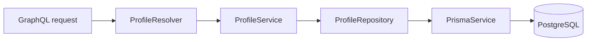

# Цифровая визитка — GraphQL API

Backend-приложение с данными Артёма Павлова: профилем, профессиональными ссылками, навыками, опытом работы и проектами. API доступен только для чтения; интерактивная документация открывается в Apollo Sandbox.

**Публичный API:** [Apollo Sandbox на Railway](https://api-production-29f8f119.up.railway.app/graphql). Чистый и повторный запуск через Docker проверен.

## Стек

Node.js 24 · TypeScript · NestJS 12 · Apollo Server · GraphQL · Prisma 7 · PostgreSQL 17 · Docker Compose · Vitest

## Быстрый запуск в Docker

Нужны Docker и Docker Compose. Локальный Node.js и ручная подготовка базы не требуются.

```bash
docker compose up --build
```

После запуска откройте [http://localhost:3000/graphql](http://localhost:3000/graphql). Контейнер приложения сам:

1. ждёт готовности PostgreSQL;
2. применяет миграции через `prisma migrate deploy`;
3. заполняет базу данными из `src/database/seed-data.ts`;
4. запускает NestJS.

Если миграция или seed завершаются ошибкой, приложение не стартует с неподготовленной базой.

Порты можно изменить через переменные окружения:

```bash
PORT=3300 POSTGRES_PORT=55432 docker compose up --build
```

В этом примере Apollo Sandbox будет доступен на `http://localhost:3300/graphql`. PostgreSQL публикуется только на `127.0.0.1` для локальной разработки.

Остановка и повторный запуск:

```bash
docker compose down
docker compose up
```

Seed выполняется при каждом запуске и не создаёт дублей. Чтобы удалить volume вместе с содержимым базы и повторить запуск с нуля:

```bash
docker compose down -v
docker compose up --build
```

## Деплой на Railway

Production-проект `digital-business-card` содержит сервисы `api` и `Postgres`. Приложение получает `DATABASE_URL` через ссылку на переменную PostgreSQL; миграции и seed выполняются тем же entrypoint, что и в Docker Compose.

Повторный деплой из локальной копии:

```bash
npx --yes @railway/cli login
npx --yes @railway/cli link --project digital-business-card --environment production --service api
npx --yes @railway/cli up --service api
```

## Пример GraphQL-запроса

```graphql
query {
  profile {
    name
    description
    links {
      label
      url
    }
    skills {
      name
    }
    experience {
      company
      position
      startedAt
      endedAt
      achievements
    }
    projects {
      name
      url
    }
  }
}
```

GraphQL возвращает только запрошенные поля. Например, для получения имени и навыков достаточно:

```graphql
query {
  profile {
    name
    skills {
      name
    }
  }
}
```

Полная сгенерированная схема находится в [`src/schema.gql`](src/schema.gql). `endedAt: null` обозначает текущее место работы, а `Project.url: null` — отсутствие публичной ссылки на проект.

Проверка API из терминала:

```bash
curl http://localhost:3000/graphql \
  -H 'Content-Type: application/json' \
  --data '{"query":"{ profile { name skills { name } } }"}'
```

## Архитектурные решения

### Разделение ответственности

Поток чтения профиля:



- **`ProfileResolver`** определяет публичный GraphQL-контракт и преобразует selection set в набор запрошенных связей. Поддерживаются alias, inline fragments и именованные fragments.
- **`ProfileService`** реализует чтение единственного профиля и возвращает ошибку, если профиль не найден. Сервис не зависит от GraphQL и Prisma.
- **`ProfileRepository`** строит Prisma-запрос и задаёт порядок связей. Он не зависит от GraphQL.
- **`PrismaService`** владеет подключением к PostgreSQL через `@prisma/adapter-pg`.

Отдельные repository для навыков, ссылок, опыта и проектов не создаются: они являются частями одного агрегата визитки, а дополнительные классы не дали бы новой ответственности.

### Оптимизация вложенных данных

Repository передаёт в Prisma `include` только для связей, присутствующих в GraphQL selection set.

- Запрос `profile { name }` читает только профиль.
- Запрос со всеми связями выполняет один запрос профиля и по одному запросу для каждого выбранного типа связи — не более пяти запросов для текущей схемы.
- Количество запросов не растёт с числом навыков, мест работы или проектов: проблемы N+1 по элементам списка нет.

**DataLoader намеренно не используется.** Он полезен для батчинга одной связи у списка родительских объектов, но здесь существует только один профиль. Request-scoped loaders и `@ResolveField` добавили бы инфраструктуру без выигрыша от батчинга.

Принудительный `relationLoadStrategy: 'join'` также не применяется: join нескольких независимых списков создаёт декартово произведение строк. Оптимизируются только вложенные связи; скалярные поля самого профиля читаются целиком.

### Code-first и генерируемый код

TypeScript-модели NestJS являются источником GraphQL SDL. Схема сортируется лексикографически и генерируется в `src/schema.gql`; в production-контейнере она строится в памяти. Файл SDL не редактируется вручную.

Prisma Client генерируется из `prisma/schema.prisma` во время `npm install` и при сборке Docker-образа. Сгенерированный клиент исключён из Git и Prettier. Исходная Prisma-схема проверяется через `prisma format` и `prisma validate`.

### Миграции и seed

Миграции хранятся в `prisma/migrations` и являются единственным способом изменения схемы базы. Production-образ содержит миграции, Prisma CLI и скомпилированный seed.

Профиль имеет стабильный внутренний идентификатор. В одной транзакции seed обновляет его скалярные поля, удаляет старые связи и создаёт актуальные. Поэтому повторный запуск воспроизводим и не накапливает дубли.

**Важно:** `src/database/seed-data.ts` — источник истины для содержимого визитки. Ручные изменения связанных записей в базе будут перезаписаны при следующем запуске. Телефон и другие личные контакты из резюме в публичный API не включены.

## Локальная разработка

Нужны Node.js 24, npm и PostgreSQL из Docker Compose.

```bash
cp .env.example .env
npm install
docker compose up -d --wait db
npm run db:migrate:deploy
npm run build
npm run db:seed
npm run start:dev
```

`npm install` запускает `prisma generate`, поэтому `.env` создаётся до установки зависимостей. Локальный seed использует скомпилированный `dist/database/seed.js`, поэтому перед ним выполняется build.

После изменения `prisma/schema.prisma` создайте новую миграцию:

```bash
npm run db:migrate:dev -- --name describe_change
```

## Проверки

```bash
npm run test          # unit-тесты selection set, repository и service
npm run test:e2e      # GraphQL + реальная PostgreSQL; два seed подряд
npm run lint          # Oxlint с type-aware анализом
npm run build         # production TypeScript build
npm run format        # Prettier + prisma format
npm audit             # проверка зависимостей
```

Перед `test:e2e` должны быть запущены база и миграции, а `.env` должен содержать корректный `DATABASE_URL`. Тест сам выполняет seed и проверяет вложенный запрос, отсутствие дублей и Apollo Sandbox.

## Основные файлы

- [`architecture.md`](architecture.md) — согласованные границы и инварианты архитектуры.
- [`goal-and-requirements.md`](goal-and-requirements.md) — требования и критерии готовности.
- [`src/profile`](src/profile) — GraphQL API, бизнес-логика и repository.
- [`src/database/seed-data.ts`](src/database/seed-data.ts) — содержимое визитки.
- [`prisma/schema.prisma`](prisma/schema.prisma) — модель базы данных.
- [`compose.yaml`](compose.yaml) и [`Dockerfile`](Dockerfile) — воспроизводимый запуск.
